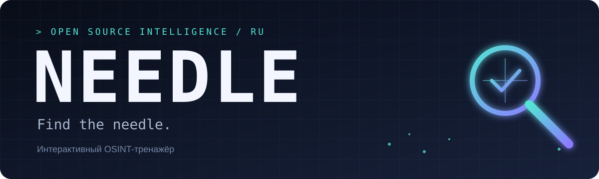
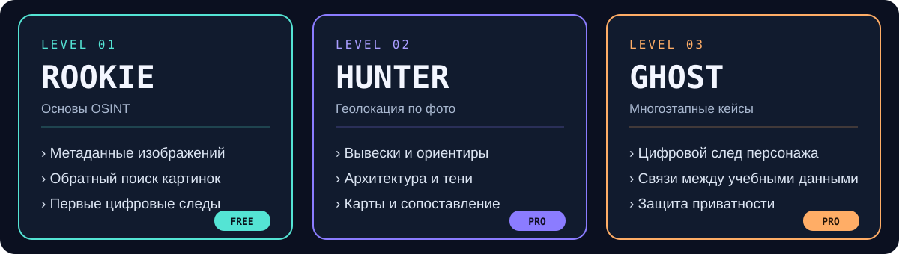
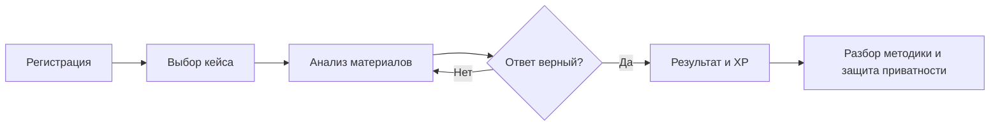
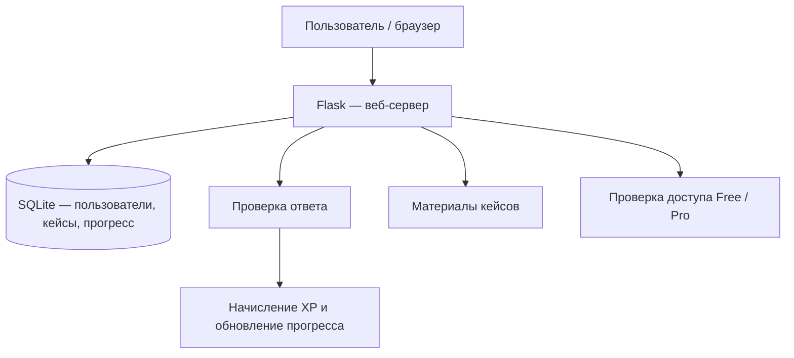

  

  <b>Find the needle.</b> 
  Интерактивный OSINT-тренажёр на русском языке

  
  
  
  

---

## О проекте

**Needle** — веб-платформа для изучения OSINT (поиска и анализа информации из открытых источников) через интерактивные задания.

Пользователь выбирает учебный кейс, анализирует предоставленные материалы, вводит ответ и получает подсказки и разбор решения. Цель платформы — научить применять базовые методы OSINT и понимать, как защищать собственный цифровой след.

**Все задания строятся на вымышленных персонажах, собственных фотографиях команды и безопасных учебных сценариях.** Платформа не предназначена для поиска или отслеживания реальных частных лиц.

## Основные возможности

- Практические задания с разными уровнями сложности.
- Проверка ответов в формате флага.
- Подсказки во время прохождения.
- Разбор каждого задания: методика, инструменты и способы защиты.
- Личный профиль и история прохождения.
- Игровые очки (XP), уровни и достижения.
- Рейтинг пользователей.
- Бесплатный и расширенный доступ.

## Уровни

  

| Уровень | Содержание |
|---|---|
| **Rookie** | Основы OSINT, метаданные изображений и обратный поиск картинок |
| **Hunter** | Геолокация по фотографиям: вывески, архитектура, ориентиры и тени |
| **Ghost** | Многоэтапные учебные кейсы по цифровому следу вымышленных персонажей и способы защиты приватности |

## Как проходит задание

1. Пользователь регистрируется и выбирает кейс.
2. Изучает фотографию и другие предоставленные материалы.
3. Ищет ответ, используя изученные методы OSINT.
4. При необходимости открывает подсказки.
5. Отправляет ответ в формате флага.
6. Получает результат, XP и разбор решения.

## Модель доступа

| Возможность | Free | Pro |
|---|---|---|
| Базовые задания | 5 кейсов | Все кейсы |
| Уровни | Rookie | Rookie, Hunter, Ghost |
| Подсказки и проверка | Да | Да |
| Разборы | Базовые | Полные разборы и дополнительные материалы |

В учебном прототипе оплата не подключается. Доступ Pro демонстрируется переключением соответствующего признака пользователя в базе данных. Реализация платёжной системы может быть отдельным этапом.

## Технологии

| Часть проекта | Технологии |
|---|---|
| Серверная часть | Python, Flask |
| Работа с данными | SQLAlchemy |
| База данных | SQLite |
| Интерфейс | HTML, CSS, JavaScript, Jinja2 |
| Карты | Leaflet |
| Контроль версий | Git, GitHub |

## Архитектура

## Безопасность и правила использования

- Используются только вымышленные персонажи и подготовленные учебные материалы.
- Не используются персональные данные реальных частных лиц.
- Пароли хранятся в виде стойких хэшей.
- Предусматриваются ограничения попыток отправки ответов.
- Используются средства защиты от SQL-инъекций, XSS и CSRF.
- В разборах объясняется, как уменьшить собственный цифровой след и защитить приватность.

## Команда

В публичном репозитории участники указаны по рабочим псевдонимам.

| Роль | GitHub |
|---|---|
| Team Lead / Backend | `erozz77` |
| Frontend | `cauua uuiqpp` |
| Content | `4byb4k47` |
| Security | `nikita backd00r` |

## Статус разработки

- [x] Концепция и название проекта
- [x] Определение уровней и основных функций
- [ ] Прототип сайта
- [ ] Регистрация и личный кабинет
- [ ] Первые учебные кейсы и проверка ответов
- [ ] Подсказки, XP и достижения
- [ ] Полные разборы заданий
- [ ] Тестирование безопасности

## Запуск

Проект находится в разработке. Инструкция по установке и запуску будет добавлена после подготовки первой рабочей версии.

---

  <b>Needle</b> · <i>Find the needle.</i> 
  2026

