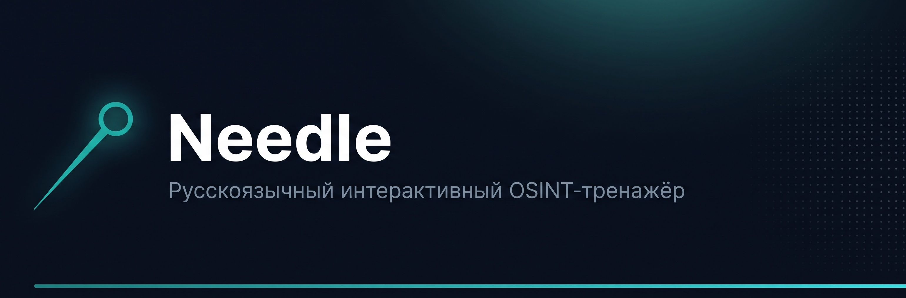
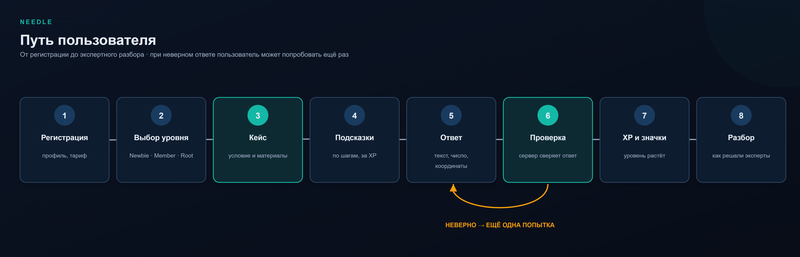
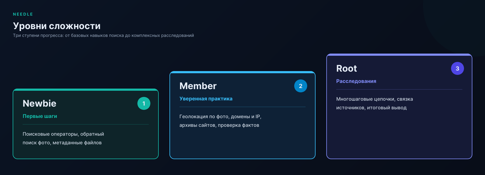
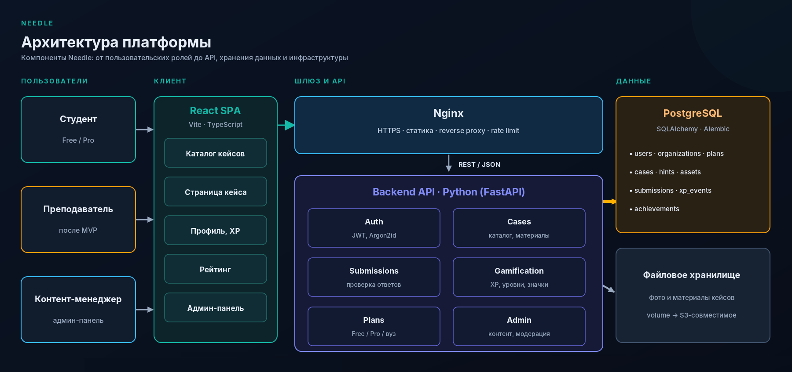
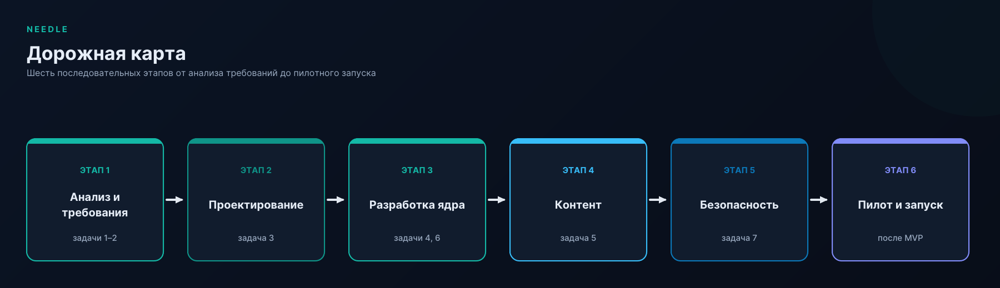

<p align="center">
  
</p>

<p align="center">
  <b>Find the needle.</b>
  <br>
  Практическая платформа для изучения OSINT
</p>

<p align="center">
  
  
  
  
</p>

---

## О проекте

**Needle** — русскоязычная веб-платформа, где студенты тренируют разведку по открытым источникам (**OSINT**) на практических кейсах: ищут информацию, проверяют её достоверность, отправляют ответ — и сразу получают проверку, очки опыта (XP) и разбор решения.

> **Для кого:** студенты бакалавриата по направлению «Информационная безопасность» и кафедры, которым нужен готовый практический модуль.

## Зачем это нужно

- Работодатели ищут OSINT-аналитиков **с опытом от 1 года**.
- В вузах нет подготовки по OSINT как профессии — только отдельные семинары и спецкурсы.
- Платные курсы стоят **от 18 до 78 тыс. ₽** и проходятся один раз.

> **Needle** даёт доступную практику, с которой можно начать, и накапливает прогресс, а не заканчивается вместе с курсом.

## Возможности

| **Кейсы** | **Автопроверка** | **Подсказки** |
| :---: | :---: | :---: |
| Не менее 15 заданий трёх уровней сложности | Текст, число или координаты — ответ проверяется сразу | Поэтапные, за небольшую цену в XP |
| **XP и достижения** | **Разборы** | **Безопасно** |
| Уровни, значки, рейтинг | Как эксперт решал бы этот кейс | Только вымышленные и собственные материалы |

## Как это работает

<p align="center">
  
</p>

## Три уровня сложности

<p align="center">
  
</p>

## Архитектура

<p align="center">
  
</p>

| Слой | Технологии |
| :--- | :--- |
| **Клиент** | `React`, `TypeScript`, `Vite`, `Tailwind CSS` |
| **Сервер** | `Python`, `FastAPI`, `Pydantic` |
| **База данных** | `PostgreSQL`, `SQLAlchemy`, `Alembic` |
| **Безопасность** | `JWT в httpOnly-cookie`, `Argon2id`, ограничение частоты запросов |
| **Инфраструктура** | `Nginx`, `Docker Compose`, `GitHub Actions` |

<p align="center">
  
</p>

## Дорожная карта

<p align="center">
  
</p>

- [x] Анализ аналогов и требования
- [ ] Проектирование: архитектура, схема базы данных
- [ ] Разработка ядра: регистрация, профили, проверка ответов, XP
- [ ] Контент: 15+ кейсов, подсказки, разборы
- [ ] Тестирование безопасности
- [ ] Пилот со студентами и запуск версии 1.0

## Безопасность и этика

> [!IMPORTANT]
> Все кейсы строятся на **собственных и вымышленных материалах**: без реальных частных лиц, закрытых баз и обхода защиты. Цель платформы — научить методу поиска и проверки информации, а не получать данные о людях.

## Быстрый старт

> [!NOTE]
> Раздел заполним после выхода первой рабочей версии. Планируется запуск одной командой:

```bash
git clone https://github.com/erozz77/Needle.git
cd Needle
docker compose up
```

<details>
<summary><b>Планируемая структура репозитория</b></summary>

```text
Needle/
├── backend/            # FastAPI: API, проверка ответов, XP
├── frontend/           # React + TypeScript: интерфейс
├── cases/              # материалы кейсов: фото, файлы, разборы
├── docs/               # документация и схемы
├── docker-compose.yml
└── README.md
```

</details>

## Команда

<p align="center">
  <b>Built by a team of four</b>
  <br><br>
  <code>erozz</code> · <code>cauua</code> · <code>4byb4k47</code> · <code>nikita backd00r</code>
</p>

---

<p align="center">
  <b>Needle</b>
  <br>
  Find the needle
  <br><br>
  <sub>Educational OSINT Platform · 2026</sub>
</p>
