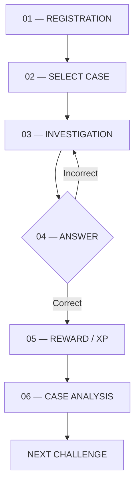
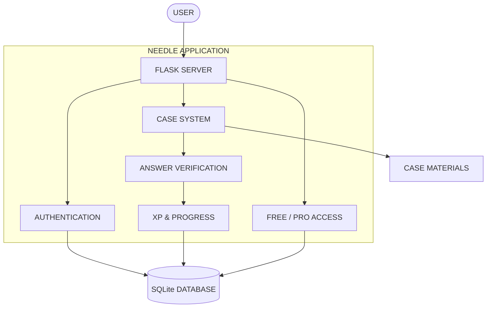

 

# NEEDLE

### FIND THE NEEDLE.

**Интерактивный OSINT-тренажёр на русском языке**

Исследуй. Анализируй. Находи закономерности.

 

---

## `01` / OVERVIEW

**Needle** — интерактивная образовательная платформа, предназначенная для изучения методов OSINT (Open Source Intelligence) через практические задания и реалистичные учебные сценарии.

Вместо обычного изучения теории пользователь получает задачу, анализирует материалы, ищет закономерности и самостоятельно приходит к ответу.

**Главная идея:** научиться находить информацию, анализировать цифровые следы и понимать, как защищать собственную приватность.

> Все учебные сценарии основаны на вымышленных персонажах и специально подготовленных материалах. Платформа не предназначена для поиска или отслеживания реальных частных лиц.

## `02` / TRAINING SYSTEM

| LEVEL 01 | LEVEL 02 | LEVEL 03 |
|:---:|:---:|:---:|
| **ROOKIE** | **HUNTER** | **GHOST** |
| Основы OSINT | Геолокация | Комплексный анализ |
| `BEGINNER` | `INTERMEDIATE` | `ADVANCED` |

### 🟢 ROOKIE — Начальный уровень

Знакомство с основными инструментами и методами OSINT.

- Анализ метаданных изображений (EXIF).
- Обратный поиск изображений.
- Поиск информации в открытых источниках.
- Основы цифрового следа.

### 🟡 HUNTER — Средний уровень

Развитие навыков анализа визуальной информации.

- Геолокация по фотографиям.
- Анализ архитектуры и окружающей среды.
- Поиск ориентиров и вывесок.
- Анализ теней и других визуальных признаков.

### 🔴 GHOST — Продвинутый уровень

Комплексные многоэтапные расследования в безопасной учебной среде.

- Анализ совокупности цифровых следов.
- Сопоставление нескольких источников информации.
- Решение комплексных OSINT-кейсов.
- Методы защиты личной информации.

---

## `03` / HOW IT WORKS

Каждое задание представляет собой отдельный учебный кейс.

1. Пользователь выбирает задание.
2. Получает фотографию и дополнительные материалы.
3. Анализирует информацию с помощью OSINT-методов.
4. При необходимости использует подсказки.
5. Отправляет ответ в формате флага.
6. Получает XP и подробный разбор решения.

## `04` / PLATFORM FEATURES

| Функция | Описание |
|:---|:---|
| **Case System** | Система интерактивных учебных кейсов |
| **Flag Verification** | Автоматическая проверка ответов |
| **Hints** | Подсказки для прохождения заданий |
| **Case Analysis** | Разбор методов и инструментов |
| **User Profile** | Личный кабинет пользователя |
| **Progress Tracking** | История прохождения и прогресс |
| **XP & Levels** | Игровая система опыта и уровней |
| **Achievements** | Достижения за выполнение заданий |
| **Leaderboard** | Рейтинг пользователей |
| **Free / Pro** | Два уровня доступа к платформе |

## `05` / ACCESS SYSTEM

Предусмотрена двухуровневая модель доступа.

| Возможности | FREE | PRO |
|:---|:---:|:---:|
| Базовые задания | 5 кейсов | Все кейсы |
| ROOKIE | ✓ | ✓ |
| HUNTER | — | ✓ |
| GHOST | — | ✓ |
| Подсказки | ✓ | ✓ |
| Проверка ответов | ✓ | ✓ |
| Разборы | Базовые | Полные |
| Дополнительные материалы | — | ✓ |

В рамках учебного прототипа PRO-доступ активируется через изменение соответствующего признака пользователя в базе данных. Платёжная система не входит в текущую реализацию.

---

## `06` / TECHNOLOGY STACK

| LAYER | TECHNOLOGY |
|:---|:---|
| Backend | Python 3.x / Flask |
| ORM | SQLAlchemy |
| Database | SQLite |
| Frontend | HTML / CSS / JavaScript |
| Templates | Jinja2 |
| Maps | Leaflet |
| Version Control | Git / GitHub |

## `07` / SYSTEM ARCHITECTURE

**Принцип работы:** Flask обрабатывает запросы пользователя, взаимодействует с базой данных, выдаёт материалы кейсов и проверяет отправленные ответы. После успешного решения обновляется прогресс пользователя.

## `08` / SECURITY & PRIVACY

Безопасность является частью образовательной концепции проекта.

- Только вымышленные персонажи и подготовленные материалы.
- Отсутствие намеренного использования персональных данных реальных частных лиц.
- Хранение паролей в виде криптографических хэшей.
- Ограничение количества попыток отправки ответов.
- Защита от SQL-инъекций.
- Защита от XSS и CSRF.
- Обучение методам сокращения собственного цифрового следа.

## `09` / DEVELOPMENT TEAM

| ROLE | GITHUB |
|:---|:---|
| Team Lead / Backend | `erozz` |
| Frontend Developer | `cauua uuiqpp` |
| Content Developer | `4byb4k47` |
| Security | `nikita backd00r` |

## `10` / ROADMAP

- [x] Разработка концепции проекта
- [x] Определение названия и уровней
- [x] Проектирование функциональности
- [ ] Создание веб-интерфейса
- [ ] Реализация регистрации и авторизации
- [ ] Создание первых учебных кейсов
- [ ] Система проверки ответов
- [ ] Подсказки и система XP
- [ ] Достижения и рейтинг
- [ ] Раздел подробных разборов
- [ ] Тестирование безопасности

## `11` / INSTALLATION

> Проект находится в стадии разработки. Инструкция по установке и запуску будет опубликована после подготовки первой рабочей версии.

---

### NEEDLE

**FIND THE NEEDLE.**

*Learn OSINT. Think critically. Protect your privacy.*

`© 2026 NEEDLE PROJECT`

